  <picture>
    <source media="(max-width: 600px)" srcset="./assets/night-city-movil.svg">
    
  </picture>

  
  
   
  

  <picture>
    <source media="(max-width: 600px)" srcset="./assets/atlantis-movil.svg">
    
  </picture>

<picture>
  <source media="(max-width: 600px)" srcset="./assets/actividad-movil.svg">
  
</picture>

  <a href="https://www.linkedin.com/in/aaron-bonilla-13014a219/">
    <picture>
      <source media="(max-width: 600px)" srcset="./assets/contacto-movil.svg">
      
    </picture>
  </a>

