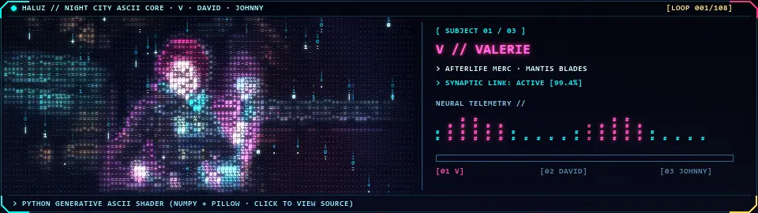
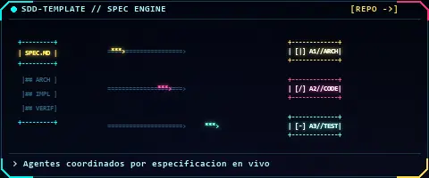
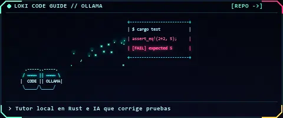
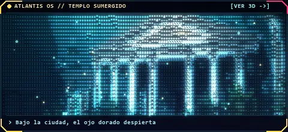
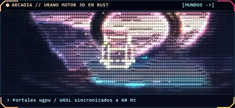
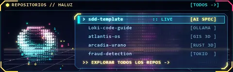
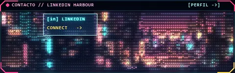

  <picture>
    <source media="(max-width: 600px)" srcset="./assets/night-city-movil.svg">
    
  </picture>

  <a href="./scripts/ascii_glow.py" title="Ver generador ASCII en Python (NumPy + Pillow)">
    <picture>
      <source media="(prefers-reduced-motion: reduce)" srcset="./assets/haluz-ascii-static.webp">
      
    </picture>
  </a> 
   
   
  

<picture>
  <source media="(max-width: 600px)" srcset="./assets/actividad-movil.svg">
  
</picture>
