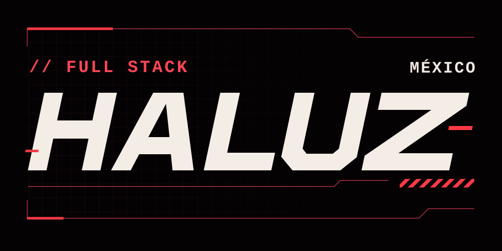

  

Soy **Haluz**, desarrollador full stack en México. Trabajo con TypeScript y React en la interfaz, y con Node.js y Rust del lado del servidor.

## Proyectos destacados

  
  

[Ver todos mis repositorios →](https://github.com/aaronestradabonilla777?tab=repositories)

  

