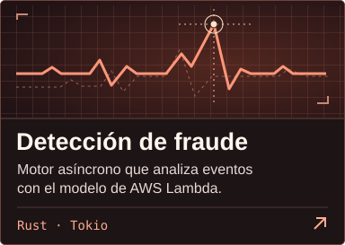

  

Soy **Haluz**, desarrollador full stack en México. Trabajo con TypeScript y React en la interfaz, y con Node.js y Rust del lado del servidor.

## Proyectos destacados

  
  

[Ver todos mis repositorios →](https://github.com/aaronestradabonilla777?tab=repositories)

<picture>
  <source media="(max-width: 600px)" srcset="./assets/actividad-movil.svg">
  
</picture>

  

  
Ver el GIF Samurai original

  

    
  

