# Arcadia

Arcadia es un mundo virtual multijugador que estoy construyendo en Rust. **Urano** es su motor 3D. En este adelanto puedes ver sus dos primeros escenarios y el arco que permite pasar de uno a otro.

  

La ilustración reproduce las posiciones y proporciones de las escenas del prototipo. El cristal turquesa del primer mundo está dibujado a partir de los vértices de `oasis_spire.glb`, uno de los modelos que puede cargar Urano.

En el cliente nativo puedes explorar a pie, saltar y alternar entre primera y tercera persona. Al cruzar el portal pasas al otro mundo. El servidor sincroniza los avatares a 60 Hz y el motor dibuja la escena con wgpu y shaders WGSL.

**Presentación próximamente.**

[Volver al perfil](../README.md)
