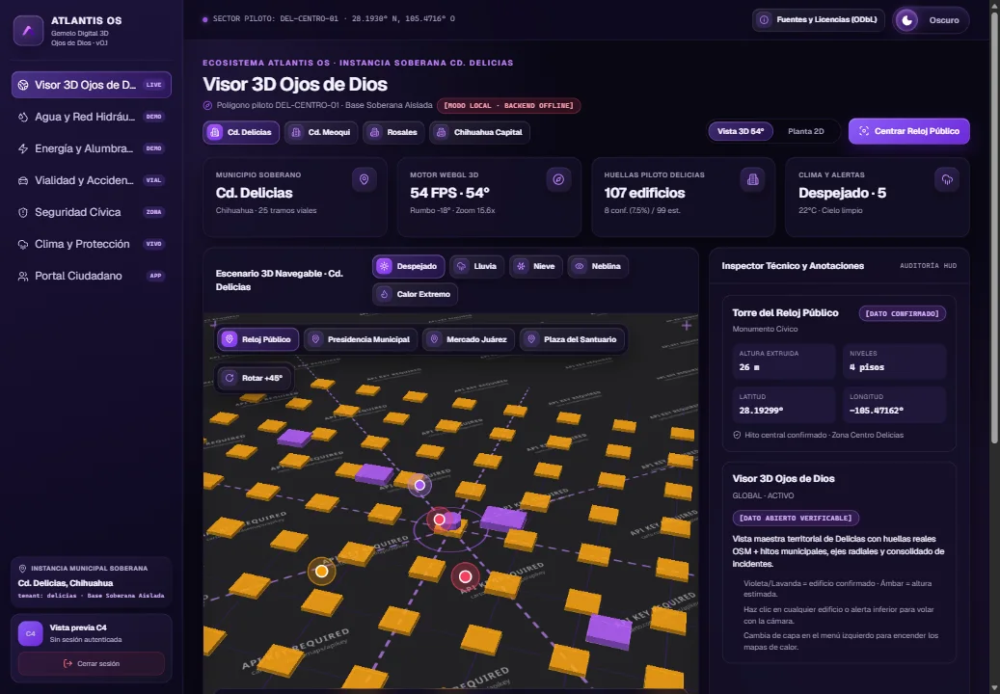

# Atlantis OS · Ojos de Dios

Así se ve el prototipo en el centro de Delicias, Chihuahua. En esta grabación de la vista previa local, el visor pasa de cielo despejado a lluvia simulada.

<picture>
  <source media="(prefers-reduced-motion: reduce)" srcset="./visor.jpg">
  
</picture>

### El visor 3D

En el centro está la Torre del Reloj Público. Al elegir un edificio, el inspector muestra su altura y procedencia. Los edificios violeta tienen altura confirmada y los ámbar, estimada. [Ampliar el visor](./visor.jpg)

### La misma plaza bajo la lluvia

Al activar **Clima y Protección → Lluvia**, la torre sigue seleccionada y conserva su ficha en el inspector. [Ampliar la simulación de lluvia](./lluvia.jpg)

Cartografía de [OpenStreetMap y sus colaboradores](https://www.openstreetmap.org/copyright) y [CARTO](https://carto.com/attributions).
